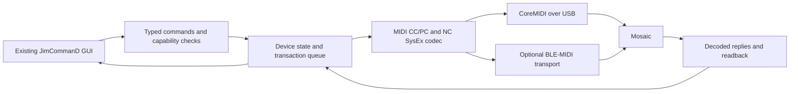

# JimCommanD — Mosaic / Intel Mac project record

Updated 7 September 2026 (including the current GUI source export). Owner: James. This is the entry point for continuing the project.

The project is an Intel-compatible Mac controller for the LIVTRA Mosaic, using James’s existing JimCommanD GUI. The work is now consolidated: previous decisions, local manuals, binary identities, protocol evidence, current hardware observations, and a tested offline protocol codec are together here. The offline editor and Intel app shell now build; the hardware backend and complete NAM/IR transfer implementation are **not yet finished**.

## Current position

| Area | Established | Still needed |
|---|---|---|
| Intel compatibility | Host is x86_64; both supplied ToneCommand app launchers and native backends are ARM64 | Build our own Intel controller/backend |
| USB | Mosaic is present in IORegistry as Ember `33C3:1302`, 12 Mbps | Successful CoreMIDI session and live command/reply capture |
| Bluetooth | Current screenshot shows Mosaic Audio connected; prior Mac test identified BLE-MIDI services | Current application-level BLE-MIDI session; audio connection alone is not this session |
| GUI | Live Figma Make contains the agreed Amplifier/Pedal layout and controls; extracted GUI now has local draft persistence, checked asset metadata and explicit offline status | Replace the offline planner with verified backend state |
| MIDI CC/PC | Manufacturer guide documents normal effects, parameters, tuner and preset recall | Firmware/channel confirmation and live validation |
| Proprietary SysEx | Request/reply framing independently checked in 1.2.7 disassembly | Confirm against 1.2.8 and the pedal’s installed firmware |
| NAM | Slot metadata query and block-read evidence; offline request encoding | Complete metadata fields, transfer/write/commit/readback validation |
| IR | Separate library/state fields and documented cabinet controls | Complete catalogue and transfer command family |
| Firmware | Local `mosaic-1.10.fmu` indexed and hashed | Full package validation/route mapping; installed firmware remains unknown |

Start with [the protocol specification](PROTOCOL.md), [the codec](backend/protocol.py), and [the remaining-work table](#next-work-in-order). Supporting files are in [reference/](reference/).

## Decisions carried forward

- **USB MIDI is the primary control path.** USB audio stays with macOS/the DAW. Bluetooth MIDI is an optional additional control transport. Bluetooth audio is not the recording path.
- The iPhone connection failed on both phones. Development must work directly from the Mac; asking James to use the iPhone app again is not the next step.
- Improve the workflow using the supplied GUI. Do not redesign it from an older export or copy ToneCommand’s weak points.
- Product name remains **JimCommanD**. The user’s corrected phrase was “the GUI”; “Transitive” was not a requested product rename.
- Amplifier and Pedal have separately organised NAM libraries. The intended logical allocation is **20 amplifier positions and 10 pedal positions**. Cabinet IR is separate.
- Keep input gain at the requested **−12 to +12 dB** in the GUI. This is a product choice, not proof of the device encoding.
- Firmware updating is an intended later capability. Alternative firmware, two simultaneous NAM stages, TONE3000 integration, and a generic multi-device business are separate future investigations.
- The user authorised autonomous project work and then asked to keep expenditure low. Reuse this record and existing evidence; prefer local tools and focused checks over repeated searches and additional agents. No credit reset has been redeemed.

## The GUI to use

**Current source of design intent:** [GUI for Intel Mac — Figma Make]([private Figma design link removed]).

File key: `PRIVATE_FIGMA_FILE`. The live preview was inspected on 7 September and shows Version 9 in the surrounding Make UI. It includes:

- JimCommanD branding; the left preset sidebar removed.
- Selectable IN stage with input gain.
- FX1, FX2, PED, AMP, CAB, DEL, MOD, REV and EQ sections.
- Amplifier library with 20 positions and custom `.nam`/`.nam2` picker.
- Pedal Capture section, recorded in the GUI task as 10 positions mapped to logical NAM positions 21–30.
- Cabinet IR controls and custom `.wav`/`.ir` picker; Mic Dist removed.
- Contextual panels: only the selected section’s controls are shown. The drum-machine tab was removed from this contextual area.

The source export at `<HOME>/Downloads/GUI for Intel Mac (1)` is **older**. Its `src/App.tsx` still contains Mic Dist and the old sidebar/default data. Do not overwrite the live GUI with it. The separate Xcode project `<HOME>/Downloads/MOSAIC` currently contains a Hello World `ContentView`; it is not the implemented controller.

The Figma connector successfully listed source resources, but the resource reader could not retrieve App.tsx. This was resolved through the existing authenticated Chrome editor: **Download code produced a complete current source ZIP**, which passed ZIP integrity checking. The exact export is preserved as [gui-source-export.zip](reference/gui-source-export.zip); extracted current source is in [gui/](gui/), with file hashes in [gui-source-export.json](reference/gui-source-export.json). It contains Pedal Capture and omits Mic Dist. No live Figma source was changed during consolidation.

The preview displays `MOSAIC connected`, `USB-C · 48kHz`, and `v2.4.1`. These are prototype labels, not measurements or a confirmed installed firmware version. The GUI task expressly recorded that Load does not yet write files to the hardware. Current source confirms the event name `mosaic-command`: `SET_INPUT_GAIN` carries db/midiValue/transport; `LOAD_NAM_CAPTURE` carries captureKind (AMPLIFIER or PEDAL), logicalSlot, hardwareSlot, File, format and transport; `LOAD_CAB_IR` carries File, format and transport without a target slot. These are local CustomEvents, not USB transfers.

## Storage and DSP: keep these separate

The local user manual shows **75 presets**, **30 AMP entries** and **30 cabinet entries**. This establishes the documented library presentation, not writable memory capacity or wire indices. See the preserved [user manual text](reference/user-manual.txt).

A preset stores a rig configuration: selected models, effect types, parameters, bypass/order and assignments. NAM and IR are distinct model assets. Reverb, delay and modulation are built-in effect settings rather than extra NAM capture slots.

The 20/10 division is a **logical organisation chosen for our app**. It does not establish that all 30 factory positions accept custom uploads, that wire slots are one-based, or that a second NAM processor exists. James has loaded a pedal NAM into the AMP position and reported that it replaces the amplifier. A UI PED block must not imply simultaneous Pedal NAM → Amp NAM processing until independently demonstrated.

There are separate `ampSlot` and `irSlot` fields in the native code. Similar displayed slot numbers do not establish shared physical storage. Earlier comments speculating otherwise are superseded by this distinction.

## App internals and version identities

| Component | Function established or inferred | Porting implication |
|---|---|---|
| `Contents/MacOS/ToneCommand` | Native macOS launcher; ARM64 | Cannot execute directly on this Intel host |
| `App.framework/.../App` | Flutter compiled app; ARM64 slice | UI/application logic is compiled, not a ready React source tree |
| `FlutterMacOS.framework` | Flutter runtime | Existing Flutter binaries are not an Intel backend |
| `liblivtra.dylib` | Native core; imports CoreMIDI, CoreBluetooth, IOKit and audio frameworks; Rust-related strings/bridge export | Principal protocol-analysis target; reimplement proven interfaces |
| Flutter plugins | File picker, preferences, secure storage, URL launcher, audio session/playback | Ordinary app services, distinguish from pedal communication |
| `libonnxruntime.1.27.0.dylib` | Bundled inference runtime | Its presence does not establish Mosaic firmware/DSP architecture |
| `Contents/Resources/runtime/engine.dat` | 287,911,776-byte opaque data file, identical across these copies | Format/purpose not established; do not call it pedal firmware |
| Flutter assets | Localisation, drum samples/MIDI presets, NanoCore themes/fonts/images | Multi-device application content; not all Mosaic features |

Two different releases are present:

- `ToneCommand.app`: **1.2.7, build 26**. `liblivtra.dylib` SHA256 `96e79f38198a90074334604849e46e14fc707a6b8162afb90c01b2371f98c4cb`.
- `ToneCommand 2.app`: **1.2.8, build 33**, the user’s selected current reference. `liblivtra.dylib` SHA256 `eca4ac591215199ba7e43ba8381c12a1a4a86ff4638359e2fcd0cdbbe44fe7e6`.

Full paths, sizes, architectures and hashes are in [inventory.json](reference/inventory.json). Historical function addresses match the 1.2.7 copy. Do not apply those numeric addresses blindly to 1.2.8.

The 1.2.8 library exposes only a few global bridge exports (`a0`, `a1`, `a2`, `irondash_init_ffi`) in the inspected export listing. This is not a documented C API with reusable headers. CoreMIDI imports verify that ordinary MIDI APIs are involved; they do not recover the full source or every command.

## Hardware evidence and the current access gap

Current IORegistry detection: product **Mosaic**, vendor **Ember**, VID **0x33C3**, PID **0x1302**, serial **REDACTED_SERIAL**, USB link **12 Mbps**. The older protocol chat also recorded USB-MIDI interface 4, OUT `0x03`, IN `0x83`, 64-byte bulk endpoints, and 44.1 kHz stereo audio. Those detailed interface/audio observations are **historical**, not freshly enumerated here.

On 6 September, the connection task recorded Bluetooth Inspector showing `Mosaic Midi` connected/interrogating, service `03B80E5A-EDE8-4B33-A751-6CE34EC4C700`, characteristic `7772E5DB-3868-4112-A1A9-F2669D106BF3`. A separate Bluetooth Audio address was recorded; it must not be used as a substitute for a CoreBluetooth peripheral identifier.

James’s 7 September screenshot shows Bluetooth on and Mosaic Audio connected, with Mosaic Midi listed in grey. This is accepted as evidence of the audio connection. It does not invalidate the prior BLE-MIDI discovery, and it does not by itself prove a current MIDI application session.

In this execution context, `MIDIClientCreate` returned **−10833** and no usable client; source/destination enumeration returned zero. Retrying after network permission was granted produced the same result. `system_profiler` also returned empty USB data / a nil Bluetooth controller, while IORegistry clearly saw Mosaic. **The empty tool results must not be interpreted as the pedal being absent or Bluetooth being switched off.** The exact reason for the CoreMIDI failure is not yet isolated.

No MIDI/SysEx requests, firmware updates, resets or model writes have been sent to the pedal during this task. A second, browser-based diagnostic was built and visually checked: its page loads and the Check MIDI ports button requests ordinary Web MIDI access. The browser was still awaiting completion at the last observation; no ports or successful connection were claimed. The reproducible page is [midi-check.html](backend/midi-check.html), with [its recorded status](reference/web-midi-diagnostic.json). Chrome gates MIDI access through browser permission, as described in [Chrome’s documentation](https://developer.chrome.com/blog/web-midi-permission-prompt?hl=en). The [read-only diagnostic](backend/inspect_midi.py) records service failure separately from successful enumeration. Results are preserved in [device observations](reference/device-observations.json) and [CoreMIDI diagnostic](reference/coremidi-diagnostic.json).

## Backend architecture

Keep audio outside this control loop. Preserve engineering units in GUI commands until their actual device conversion is known. A `.nam` filename filter does not validate network architecture, size, or conversion requirements. A downloaded model payload may not reconstruct the original NAM JSON verbatim.

For transfers, track prepare → chunks → acknowledgements → commit → readback → selected model separately. A file picker selection, a completed local read, a sent packet, a successful commit and a verified device readback are different completion states. Retry only where the protocol makes that operation repeatable; distinguish a timeout after possible commit from a rejected write.

## Next work in order

| Priority | Work | Completion evidence |
|---|---|---|
| 1 | Obtain a usable local CoreMIDI/BLE-MIDI session | Named Mosaic endpoints or a confirmed BLE connection, plus timestamped diagnostics |
| 2 | Confirm read-only query semantics and capture replies | Matched sequence/opcode/status and raw TX/RX; no guessed discovery/reset commands |
| 3 | Decode slot metadata and catalogue addressing | Observed slot bounds, flags, names, sizes, supported custom positions |
| 4 | Complete NAM read, IR read and response validators | Reassembled data, offsets, bounds and any verified checksum/length rules |
| 5 | Map NAM/IR prepare/write/commit/readback | Proven command layouts and transfer error handling; backup before replacement |
| 6 | Connect known controls using the recovered current Figma source | Real connection status; GUI command → device response demonstrated |
| 7 | Verify preset/global settings and physical parameter scaling | Documented/observed range and model-dependent CC mapping |
| 8 | Build/package Intel application | x86_64 executable and dependency audit; native chooser/save-sheet smoke test still needed |
| 9 | Add official firmware-update support | Full Mosaic-specific package/device validation and verified recovery procedure |

## Evidence sources and reconciliation

The source conversations remain intact. They have not been merged or deleted; this record consolidates their relevant content without losing the originals.

| Source task (exact title) | ID | Contribution |
|---|---|---|
| Tone Command for Intel OSX | `PRIVATE_THREAD` | Original binary/packet analysis and requirements |
| Branch · Tone Command for Intel OSX | `PRIVATE_THREAD` | Protocol checkpoint and remaining gaps |
| Connect LIVTRA Mosaic MIDI | `PRIVATE_THREAD` | Mac BLE-MIDI and USB connection history |
| Connect LIVTRA Mosaic MIDI | `PRIVATE_THREAD` | GUI fork, changes, 20/10 allocation, missing transfer backend |
| Inspect Mosaic MIDI user guide | `PRIVATE_THREAD` | Guide findings and previous USB diagnostics |

Selected technical excerpts, including pasted assembly, are preserved in [history-excerpts.json](reference/history-excerpts.json). They are partial historical records, not independently verified facts by default. Full prior assembly notes are copied as [offsets.txt](reference/offsets.txt) and [slotinfo.txt](reference/slotinfo.txt). Current verification excerpts are [protocol-assembly.txt](reference/protocol-assembly.txt).

A bounded GitHub search for ToneCommand found a similarly named project for **Fractal FM9**, not LIVTRA Mosaic. It is excluded as a protocol source: [repository README](https://github.com/monzta1/ToneCommand/blob/main/README.md). No official LIVTRA source repository was established by this search. Generic AC696/JieLi, CH59x, DFU and NanoCore strings from the multi-device application do not identify the Mosaic’s processor or update route on their own.

Research was deliberately bounded when the essential consolidation claims had source support or explicit gaps. Two additional research workers stopped with usage-limit errors; their partial findings were independently checked where used. No further workers were launched. A planning tool was unavailable, so the plan and evidence gaps are recorded in this document.

## Verification at this checkpoint

The extracted GUI builds with TypeScript and Vite, and 19 offline editor tests pass. They cover versioned project persistence, hostile/incomplete imports, exact asset fingerprints, NAM JSON validation, RIFF/WAV structure checks, local slot identity, documented MIDI CC/PC planning, channel nibbles, preset catalogue gating and explicit unmapped controls. Eight offline codec tests also pass on this Intel Mac using Python 3.13. Tests include the prior assembly-derived request vector, an independently specified synthetic response, byte/chunk boundaries, malformed frames, fragmentation, realtime MIDI bytes and size limits. This establishes local software behaviour, **not hardware compatibility**.

`native/build.sh` produces [JimCommanD.app](JimCommanD.app) with an x86_64 executable, an ad-hoc signature, and the compiled GUI bundled inside `Contents/Resources/Web`. The shell has no MIDI, Bluetooth, USB, firmware or model-transfer APIs. It provides local file chooser support and validates version 1 project exports before showing a native save panel. Full results and the untested items are in [verification.json](reference/verification.json).

No working firmware uploader, live NAM transfer or completed GUI/backend integration is being claimed. The editor's “Check MIDI ports” action is enumeration-only and sends zero messages; a selected model or IR is inspected and fingerprinted locally, never uploaded.

To rerun: in `backend/`, run `python3 -m unittest -v`. `inspect_midi.py` is read-only and requires the installed PyObjC CoreMIDI module. The codec itself uses only the Python standard library.
